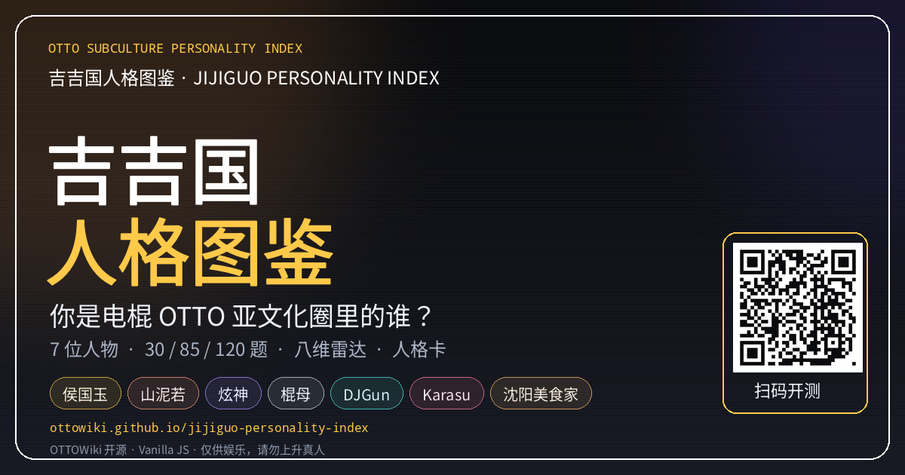
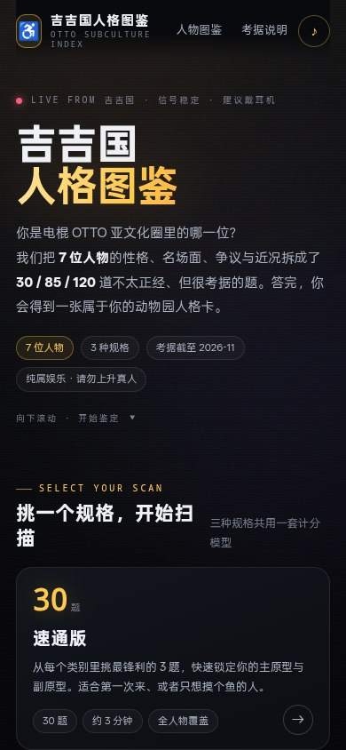
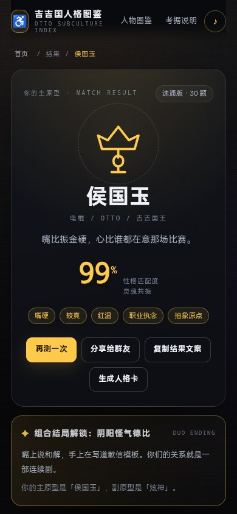
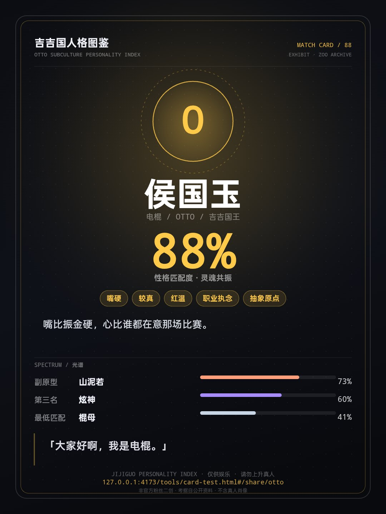
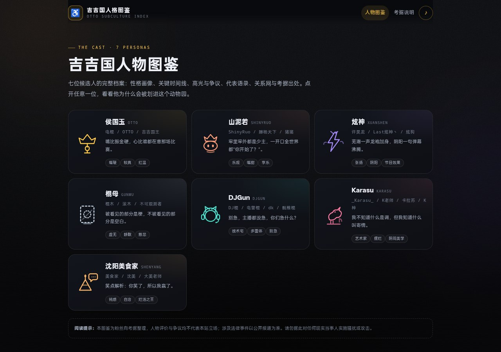
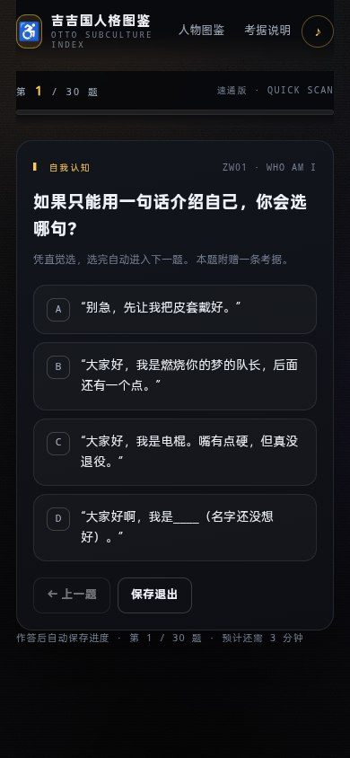

# 吉吉国人格图鉴

> 你是电棍 OTTO 亚文化圈里的哪一位？7 位人物 · 30 / 85 / 120 题 · 八维人格雷达 · 可分享人格卡。
>
> 纯 Vanilla JS，无框架、无构建、无第三方依赖、无埋点。

[](https://ottowiki.github.io/jijiguo-personality-index/)
[](https://ottowiki.github.io/jijiguo-personality-index/)
[](https://developer.mozilla.org/zh-CN/docs/Web/JavaScript)
[](LICENSE)
[](https://github.com/OTTOWiki/jijiguo-personality-index/stargazers)
[](https://github.com/OTTOWiki/jijiguo-personality-index/releases)

**在线试玩：<https://ottowiki.github.io/jijiguo-personality-index/>** · **如果觉得有意思，欢迎点一个 ⭐ Star，或把链接甩给群友。**



## 这是什么

「吉吉国人格图鉴」是一个基于**电棍 OTTO 亚文化圈公开资料考据**的趣味人格测试。用户答完 30 / 85 / 120 题后，会匹配到 7 位人物之一：

| 人物 | 别名 | 一句话 |
| --- | --- | --- |
| 侯国玉 | 电棍 / OTTO / 吉吉国王 | 嘴比振金硬，心比谁都在意那场比赛。 |
| 山泥若 | ShinyRuo / 滕杨天下 / 猪猪 | 牢里牢外都是少主，一开口全世界都“你开始了？”。 |
| 炫神 | 许昊龙 / Last炫神丶 / 炫狗 | 芜湖一声龙袍加身，阴阳一句弹幕沸腾。 |
| 棍母 | 棍木 / 滚木 / 不可观测者 | 被看见的部分是梗，不被看见的部分是空白。（虚构形象） |
| DJGun | DJ棍 / 电警棍 / dk | 别急，主播都没急，你们急什么？ |
| Karasu | _Karasu_ / K老师 / 卡拉苏 | 我不知道什么是调，但我知道什么叫寄情。 |
| 沈阳美食家 | 美食家 / 沈美 / 大美老师 | 笑点解析：你笑了，所以我赢了。 |

结果页包含：主原型与匹配度、副原型 / 第三名 / 最低匹配、七人匹配光谱、八维雷达、人格切片、高光时刻、争议与阴影、代表语录、关系网、建议、考据出处，以及可保存的 **1080×1440 人格卡**。前两名命中特定组合时解锁「组合结局」。

## 功能

- **三种规格**：30 题速通（约 3 分钟）、85 题标准（约 8 分钟，推荐）、120 题典藏（约 12 分钟）
- **考据向结果页**：第三方性格评价、正面言行、负面争议、语录、关系网、近况与来源
- **八维人格雷达**：嘴臭火力 / 抽象整活 / 情绪破防 / 社交存在 / 底线自控 / 执念韧性 / 温柔共情 / 虚无淡然
- **组合结局**：Kdk 电台、阴阳怪气德比、吉吉国梦之队、一坨史双子星等
- **分享与扩散**：结果文案、分享链接、微博 / QQ / B站动态 / 贴吧快捷分享、二维码、1080×1440 人格卡
- **好友相性**：从好友分享链接进入后完成测试，会额外解锁你与分享者的「相性卡」
- **考据梗注**：答题时掉落，结果页可展开全部「本次掉落的考据」
- **纯静态 & 隐私友好**：零依赖、无账号、无埋点、无外部请求；进度和结果只存在浏览器 localStorage
- **移动端 / 桌面端适配**：320 / 390 / 1280 宽度实测；支持键盘 1–4、← 返回、Esc 退出；尊重 `prefers-reduced-motion`

## 界面预览

| 首页（移动端） | 结果页 | 人格卡 |
| --- | --- | --- |
|  |  |  |

| 人物图鉴（桌面） | 答题 |
| --- | --- |
|  |  |

## 三档规格

题库为 **10 类 × 12 题 = 120 题**：自我认知、语言与对线、情绪与破防、游戏与胜负、创作与抽象、社交与关系、金钱与现实、底线与选择、网络冲浪、世界观。

| 规格 | 题数 | 用时 | 抽题 |
| --- | --- | --- | --- |
| 速通版 | 30 | 约 3 分钟 | 每类取前 3 题，30 题全部带梗注 |
| 标准版 | 85 | 约 8 分钟 | 每类 8–9 题，推荐 |
| 典藏版 | 120 | 约 12 分钟 | 全题库，含全部考据梗注 |

## 计分模型

- 每题 4 个选项，每个选项对 1–3 位人物加权（主权重 3，副权重 1），四个选项的主人物互不相同。
- 每位人物：`匹配比例 = 该版本中获得的权重 / 该版本中理论最高权重`。
- 展示匹配度：`round(30 + 70 × 比例^0.7)`，夹在 1–99；随机乱选通常 55–70%，取向一致可到 90%+。
- 八维雷达：把被选选项的权重投影到人物 8 维画像上加权平均，再与主原型对比。
- 排序：匹配比例 → 原始分 → 8 维距离 → 稳定哈希，保证相同答案结果可复现。
- 组合结局：取前两名，命中预设组合时显示特殊结局。

## 考据原则与伦理

1. **不只有性格标签**：每个人物都包含第三方评价、正面言行、负面争议、语录、关系网与近况。
2. **区分事实与玩梗**：判决、封禁、诉讼、道歉等以公开报道为准；社区梗标注「社区通说」；无法核实的标「待考」。
3. **不美化越界**：赌博犯罪、网暴、地域黑、侵犯名誉权等内容明确写出，不作为“节目效果”。
4. **保护真实素人**：「棍母」是虚构网络形象，照片原型是一位与电棍无关的环卫工人；请勿骚扰。现实中的电棍母亲也只是普通人。
5. **对当事人保持同情**：不嘲笑沈阳美食家的孤独与贫困，不把「一坨史」当玩家标签。

> 出于对当事人与未核实信息的保护，完整的内部考据档案不随站点公开；站内「考据说明」页列出了公共来源，欢迎在 Issue 中勘误补充。

## 本地运行

纯静态站点，无需构建：

```bash
git clone https://github.com/OTTOWiki/jijiguo-personality-index.git
cd jijiguo-personality-index
python3 -m http.server 4173 --bind 127.0.0.1
# 打开 http://127.0.0.1:4173/
```

也可以使用任意静态服务器托管本目录。无后端、无外部资源请求。

## 目录结构

```
.
├─ index.html                # 单页入口（传统 script，无构建）
├─ 404.html                  # GitHub Pages 404 兜底
├─ manifest.webmanifest      # PWA 清单
├─ robots.txt / sitemap.xml  # SEO
├─ css/style.css             # 全部样式（移动优先 / 桌面 / 动效 / 打印）
├─ js/
│  ├─ lib/util.js            # DOM、随机数、存储、音效、Toast、Modal
│  ├─ data/personas.js       # 7 人画像、结果页文案、纹章、来源
│  ├─ data/questions-{a,b,c}.js  # 120 题题库（含梗注）
│  ├─ data/versions.js       # 30/85/120 三版本定义
│  ├─ scoring.js             # 抽题、加权计分、雷达、排序、组合结局、相性
│  ├─ share.js               # 分享文案、渠道链接、Canvas 人格卡
│  ├─ views.js               # 所有页面 HTML 模板
│  └─ app.js                 # 路由、事件、进度存档、分享动作、结果动画
├─ assets/                   # 原创 SVG 纹章、PWA 图标、OG 封面、二维码、截图
├─ tools/
│  ├─ check.mjs              # 题库 / 计分 / 覆盖 / 模拟自检
│  ├─ gen-assets.py          # 生成二维码、图标、OG 封面
│  ├─ card-test.html         # 人格卡渲染预览页
│  └─ bump.mjs               # 开发用静态资源缓存版本号
├─ PROMOTION.md              # 扩散素材与发布文案
├─ LICENSE
└─ README.md
```

## 新增 / 修改题目

题库是纯数据：

```js
{
  id: 'ZW01', cat: '自我认知', q: '题干……',
  note: '题目附带的考据梗注（可省略）',
  options: [
    { t: '选项 A', w: { otto: 3 } },             // 主权重 3
    { t: '选项 B', w: { karasu: 2, djgun: 1 } }   // 也可以组合
  ]
}
```

约束（`npm run check` 会强制检查）：共 120 题、10 类各 12 题；每题 4 个选项且主人物互不相同；人物 id 只能是 `otto / shanniruo / xuan / gunmu / djgun / karasu / shenyang`；三版本题数分别 30 / 85 / 120。

## 自检

```bash
npm run check
```

会检查：题库结构、id 唯一性、权重合法性；三版本题数与分类覆盖；纯策略模拟（7 位人物都能匹配到自己）；3000 次随机策略分布；双人组合；结果与出题顺序无关等。当前 **全部通过**。

## 部署

本站部署在 GitHub Pages，使用 `master` 分支根目录（legacy Pages）：

1. GitHub 仓库 → Settings → Pages → Source 选择 `Deploy from a branch` → `master` / `/ (root)`。
2. 站点地址：<https://ottowiki.github.io/jijiguo-personality-index/>。
3. 根目录已有 `.nojekyll`，无需额外构建步骤。

## 扩散与运营

- 分享功能：结果页 →「分享给群友」→ 微博 / QQ / B站动态 / 贴吧 / 复制链接 / 保存人格卡 / 扫码分享。
- 好友相性：把带 `#/share/<人物>` 的链接发给朋友，对方测完会解锁「相性卡」。
- 发布素材与文案模板见 [PROMOTION.md](PROMOTION.md)。
- SEO / 社交预览：站内已配置 Open Graph、Twitter Card、JSON-LD FAQ、`sitemap.xml`、`robots.txt`、PWA manifest。
- 保持克制：只发相关社区，不刷屏，不打扰当事人，不用测试结果攻击具体的人。

## 贡献

欢迎提交 Issue / PR：人物资料勘误、题目优化、移动端问题、分享文案建议都可以。提交前请先跑 `npm run check`，并在 Issue 中附上来源链接。

## 主要来源

站内「考据说明」页（<https://ottowiki.github.io/jijiguo-personality-index/#/about>）列出了完整来源。常用来源包括：

- 维基百科：[吉吉国文化](https://zh.wikipedia.org/wiki/%E5%90%89%E5%90%89%E5%9B%BD%E6%96%87%E5%8C%96)
- OTTOWiki：<https://wiki.ottohub.cn/>（电棍otto / 棍母 / 山泥若 / 炫神 / DJGun / Karasu 等条目）
- 萌娘百科（镜像）：滕杨天下、许昊龙、侯国玉/吉吉国文化
- 游民星空：[B站阴间视频，是怎样解构抽象第一人的](https://www.gamersky.com/zl/202208/1509331.shtml)
- 光明网、腾讯新闻、懂球帝、17173、直播吧、新浪新闻、中国青年网等公开报道
- B 站公开空间与视频、贴吧、知乎、NGA、虎扑等社区资料

考据截至 **2026-11-21**。若你是相关当事人并认为内容有问题，请通过 Issue 联系，我们会更正或删除。

## License

- 代码：MIT（见 [LICENSE](LICENSE)）
- 本站原创文案与人物画像：CC BY-NC-SA 4.0（署名—非商业性使用—相同方式共享）
- 引用的事实与社区资料版权归各自权利人所有

## 免责声明

本站为非官方粉丝二创作品，由 OTTOWiki 组织开源维护，与电棍本人、山泥若、炫神、DJGun、Karasu、沈阳美食家及相关平台均无隶属关系。所有内容仅代表对公开网络文化的整理与娱乐化表达，不构成对任何人物的事实定性、名誉评价或法律意见。请勿据此骚扰任何现实中的当事人。

**玩梗请留在屏幕里，不要把任何恶意带到现实中的具体的人身上。**
